# webptracer

**Simulador educacional de redes de computadores que roda no navegador.**

O webptracer é um *simulador*, não um *emulador*. O comportamento de switches, roteadores e
computadores é implementado em software, por um motor de eventos discretos. Por isso ele é leve,
abre na hora, roda em qualquer máquina e é **determinístico**, o que permite pausar,
avançar passo a passo e corrigir exercícios automaticamente. O foco é o ensino. As saídas de
comandos, as mensagens de erro e os tempos dos protocolos (STP, DHCP, ARP, NDP) seguem os
equipamentos reais para que o que o aluno aprende valha no equipamento de verdade.

Versão atual: **0.1 (MVP)**. As decisões de projeto e o levantamento de trabalhos relacionados
estão em [`docs/artigo/notas-de-pesquisa.md`](docs/artigo/notas-de-pesquisa.md).

---

## Funcionalidades

### Topologia lógica
Arraste equipamentos da paleta, ligue cabos escolhendo as portas e acompanhe o estado de cada
enlace pelos LEDs: verde quando encaminha, laranja durante a convergência do STP ou em
`err-disabled`, cinza quando está desligado. Cabos diretos, cruzados e de fibra são verificados
fisicamente: portas sem auto-MDIX exigem o cabo correto.

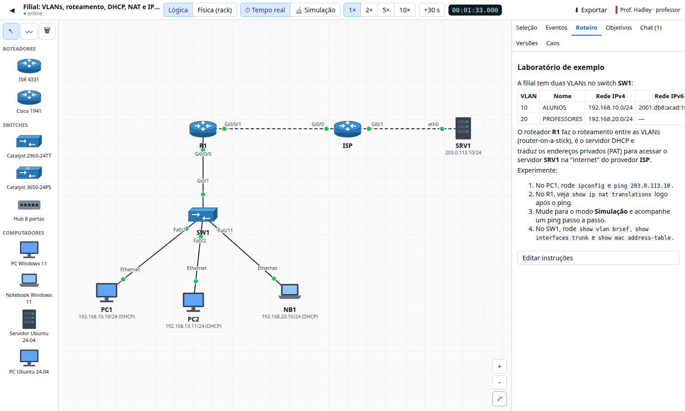

### CLI do Cisco IOS
Modos usuário, privilegiado e de configuração (interface, subinterface, faixa de interfaces,
VLAN, linha, pool DHCP e ACL nomeada). A CLI aceita abreviações (`sh ip int br`), ajuda
contextual com `?`, Tab, `do`, `no`, histórico e as mensagens de erro reais do IOS (`^`, *Incomplete* e
*Ambiguous command*). A running-config e a startup-config são a fonte da verdade:
`copy run start`, `reload`, `write erase` e senhas (`enable secret`, `service password-encryption` com o tipo 7 real) funcionam.

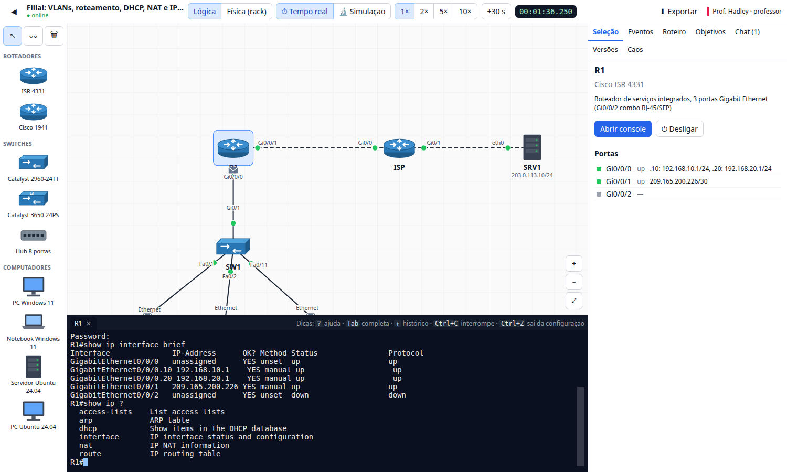

Nos switches: VLANs, portas de acesso e *trunk* 802.1Q (VLAN nativa, VLANs permitidas,
negociação dinâmica), Spanning Tree 802.1D com PortFast e BPDU Guard, tabela MAC e CDP.

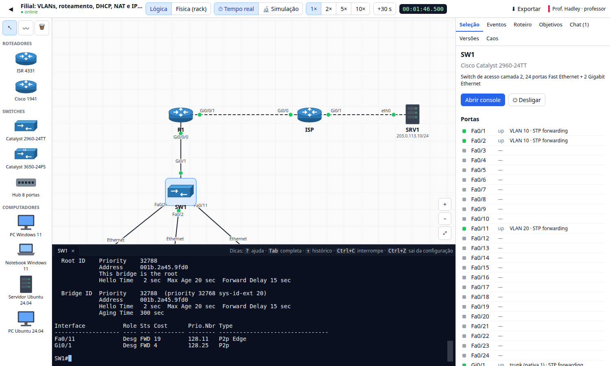

### Computadores Windows e Linux
Os PCs e notebooks Windows têm `ipconfig` (`/all`, `/release`, `/renew`), `ping`, `tracert`,
`arp`, `netsh` e `route print`, com o comportamento real (APIPA quando o DHCP falha e
"Destination host unreachable" quando o ARP falha). O servidor Ubuntu tem `ip`, `ifconfig`, `ping`
contínuo (Ctrl+C para parar), `traceroute`, `dhclient` e `sudo`.

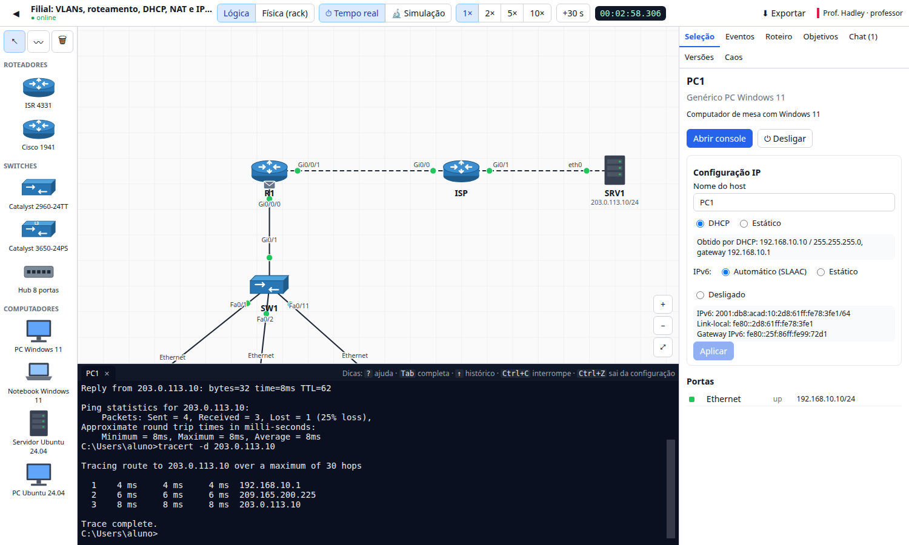

A configuração IP também pode ser feita por formulário: DHCP ou estático, e IPv6 automático
(SLAAC), estático ou desligado.

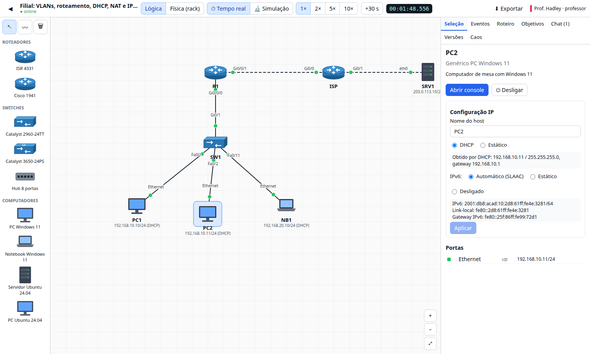

### Modo simulação e inspeção de pacotes
No modo **Simulação** o tempo para. Cada clique em *Próximo passo* entrega os quadros
seguintes, que aparecem como envelopes coloridos por protocolo andando pelos cabos. A lista de
eventos pode ser filtrada por protocolo.

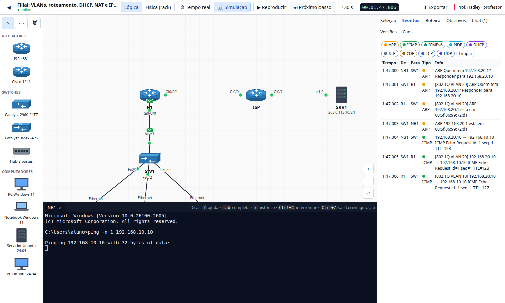

Clicando num evento, abre-se o PDU camada por camada, os **bytes reais no fio** em
hexadecimal e **o que o equipamento decidiu fazer** com o quadro (encaminhar, inundar, responder
ARP, traduzir NAT, descartar por ACL...). Cada cabo também permite baixar a captura em
`.pcap` válido, que abre no Wireshark.

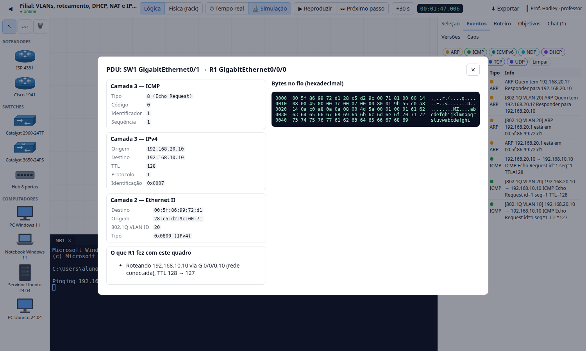

### Visão física (rack)
Os equipamentos aparecem montados no rack com o painel frontal do modelo: portas RJ-45 e SFP,
console, LEDs ao vivo e os cabos ligados às portas. Arraste pela lateral para mudar a posição
no rack.

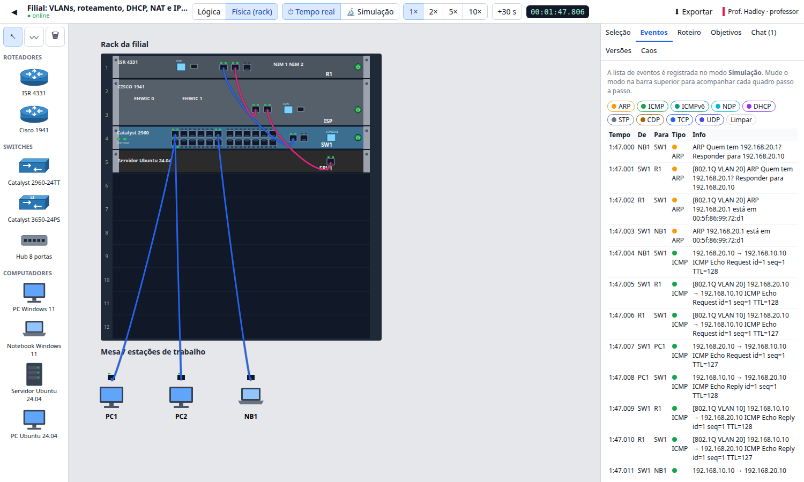

### Objetivos com correção por comportamento
O professor define objetivos como "o PC1 alcança o servidor", "o host obtém IP por DHCP" ou
"a configuração contém...". Na verificação, o laboratório é reconstruído, o tempo avança até os
protocolos convergirem e cada objetivo é **testado na rede**, por exemplo com um ping. Qualquer
solução correta é aceita, sem exigir o comando exato.

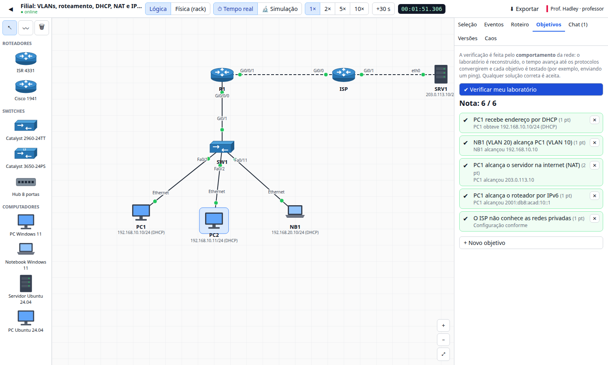

### Modo caos (treino de *troubleshooting*)
O professor injeta uma falha aleatória: cabo rompido, interface desativada, porta na VLAN
errada, gateway ou máscara incorretos, ou rota estática removida. A descrição fica visível só
para o professor, que pode enviar dicas ou desfazer a falha.

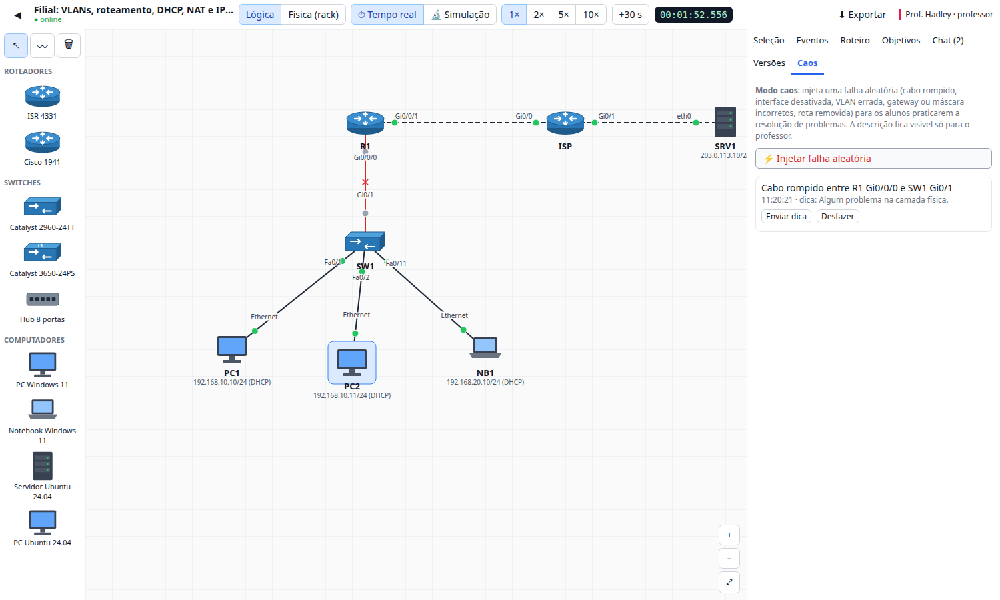

### Colaboração em tempo real
Vários alunos e o professor trabalham no mesmo laboratório ao mesmo tempo. O servidor é
autoritativo e todos veem a mesma rede. Há cursores dos participantes, chat, presença e
**versões** (salvar/restaurar, como *commits*). Os laboratórios podem ser exportados e
importados em JSON.

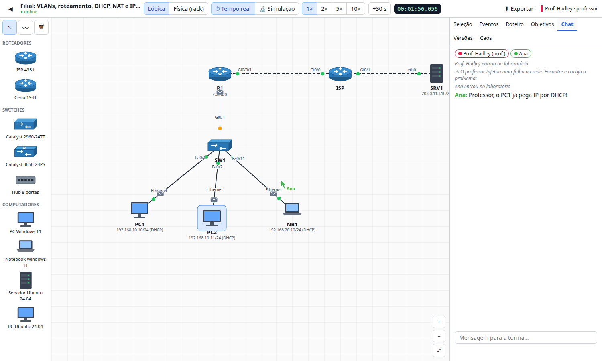

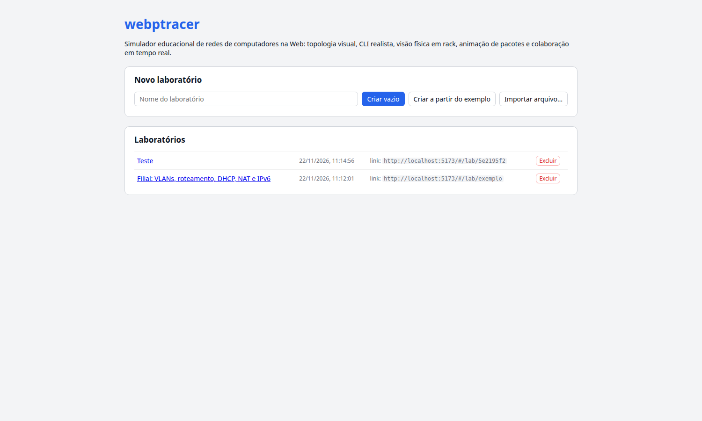

---

## Equipamentos disponíveis

| Modelo | Tipo | Portas |
|---|---|---|
| Cisco ISR 4331 | Roteador (IOS XE) | 3 × Gigabit Ethernet |
| Cisco 1941 | Roteador (IOS 15) | 2 × Gigabit Ethernet |
| Cisco Catalyst 2960-24TT | Switch camada 2 | 24 × Fast Ethernet + 2 × Gigabit |
| Cisco Catalyst 3650-24PS | Switch multicamada (L3, SVI, `no switchport`) | 24 × Gigabit PoE+ + 4 × SFP |
| Hub 8 portas | Repetidor (camada 1) | 8 × 10/100 |
| PC e notebook Windows 11 | Host | 1 × Ethernet |
| PC e servidor Ubuntu 24.04 | Host | 1 × Ethernet |

## Protocolos e recursos simulados

| Camada | Recursos |
|---|---|
| Física | Cabos direto, cruzado e fibra, auto-MDIX, velocidade e duplex, energia, cabo rompido |
| Enlace | Ethernet II e 802.3, 802.1Q, aprendizado e envelhecimento de MAC, VLANs, trunk (simplificação do DTP), STP 802.1D, PortFast, BPDU Guard, CDP, hub, controle de tempestade de broadcast |
| Rede | ARP (com o `.!!!!` do IOS no primeiro ping), IPv4, roteamento conectado e estático (rota *default* e flutuante), *router-on-a-stick*, SVIs, ICMP, ACLs padrão e estendidas (numeradas e nomeadas), NAT estático, dinâmico e PAT, IPv6 com *link-local* EUI-64, NDP, RA/SLAAC, rotas estáticas IPv6 e ICMPv6 |
| Aplicação | Servidor DHCP no roteador, *relay* (`ip helper-address`), cliente DHCP nos hosts e no IOS (`ip address dhcp`), ping e traceroute (UDP no IOS e no Linux, ICMP no Windows) |

---

## Como executar

Requisitos: Node.js 22 ou superior (testado com o 24).

```bash
npm install
npm run dev        # servidor em :3001 + interface em http://localhost:5173
```

Produção (um único processo servindo a interface compilada):

```bash
npm run build
npm start          # http://localhost:3001
```

Na primeira execução o servidor cria o laboratório de exemplo **"Filial: VLANs, roteamento,
DHCP, NAT e IPv6"**. O banco SQLite fica em `apps/server/data/` (ou no caminho de `DB_FILE`).

Dica: ao abrir um laboratório, as portas de switch ligadas a outros switches ou roteadores
passam 30 s em *listening/learning* (STP), como no equipamento real. Use o botão **+30 s** para
avançar o relógio da simulação.

## Arquitetura

```
packages/core   motor de simulação (TypeScript puro, roda no Node e no navegador)
  sim/          relógio virtual, fila de eventos, enlaces, rastreio de quadros
  devices/      catálogo de hardware, IOS (roteador/switch), hosts, hub
  l2/           bridge: MAC, VLAN, trunk, STP
  l3/           pilha IP: ARP, rotas, ICMP, ACL, NAT, DHCP, IPv6/NDP
  cli/          gramática declarativa + comandos IOS + shells Windows/Linux
  net/          endereços, PDUs, serialização em bytes reais e pcap
  lab/          documento do laboratório, correção, caos, laboratório de exemplo
apps/server     Express + Socket.IO (servidor autoritativo), Drizzle ORM + SQLite
apps/web        React + Vite: topologia SVG, rack, terminais xterm.js
docs/           notas de pesquisa (artigo) e checklist do MVP
```

| Decisão | Motivo |
|---|---|
| TypeScript em tudo | O mesmo motor serve ao servidor (colaboração) e, futuramente, ao navegador (modo offline) |
| Eventos discretos com relógio virtual | Determinismo, passo a passo e correção automática reproduzível |
| Running-config como fonte da verdade | Salvar e carregar funciona como no equipamento real e facilita versionar (diff de texto) |
| Gramática de comandos separada do modelo | Permite adicionar outros fabricantes sobre o mesmo plano de dados |
| Drizzle ORM | Troca de SQLite por PostgreSQL localizada em `apps/server/src/db.ts` |

## Testes

```bash
npm test           # vitest: CLI, ARP, STP, BPDU Guard, ACL, VLANs, pcap, laboratório de exemplo
npm run typecheck
```

## Limitações conhecidas (v0.1)

- O STP usa uma única instância para todas as VLANs (a saída imita o PVST).
- O DTP é resolvido pela configuração do vizinho, sem quadros DTP.
- As senhas tipo 5 usam um *hash* didático no lugar do MD5-crypt.
- Ainda não há roteamento dinâmico, EtherChannel, port-security, TCP de aplicação
  (HTTP, DNS, SSH) nem outros fabricantes.
- Ainda não há autenticação real: no MVP, o papel de professor ou aluno é escolhido ao entrar.
